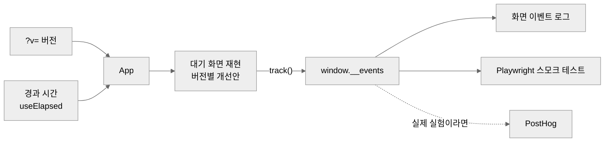

<a name="readme-top"></a>

<div align="center">

# 쇼더스 사전 과제

**무료 사용자가 결제를 미루는 지점을 찾아, 만들기 전에 수요부터 재는 프로토타입**

<a href="https://fastview-assignment-xsx1.vercel.app/">프로토타입</a> |
<a href="#">보고서</a> |
<a href="https://shortus.viewus.co.kr/">쇼더스</a>


[무엇을 검증하나](#무엇을-검증하나) | [버전 둘러보기](#버전-둘러보기) | [검증 설계](#검증-설계) | [작동 방식](#작동-방식) | [만들면서 잡은 문제](#만들면서-잡은-문제) | [실행](#실행)

</div>

<!-- TODO 사진 -->

<br>

> [!NOTE]
> 패스트뷰 Product Engineer 사전 과제입니다. 쇼더스 코드에는 접근할 수 없어서 직접 써 보며 찍은 화면을 보고 대기 화면과 결과 화면을 재현했습니다.
> 서버 없이 정해 둔 시나리오를 재생하는 프로토타입이고 결제와 데이터 저장은 하지 않습니다. 소요 시간은 보고서에 단계별로 적었습니다.

<br>

## 무엇을 검증하나

가입부터 결제 직전까지 쇼더스를 직접 써 보고, 두 주제마다 막히는 지점을 가설로 세웠습니다.

- **지정 주제:** 무료 사용자의 유료 전환율을 높인다
- **자유 주제:** 사용자 입장에서 제품 만족도를 높인다

**써 보며 확인한 사실**

- 가입하면 크레딧 150을 받습니다. 매달 채워지는 50에 가입 환영 크레딧 100이 더해지고 환영 크레딧은 7일 뒤 사라집니다.
- 기사로 만든 35초 쇼츠가 7크레딧이라, 한두 편 만드는 사람에게는 돈을 낼 이유가 늦게 생깁니다.
- 환영 크레딧의 소멸 날짜는 사이드바에 크레딧 숫자와 날짜로만 나옵니다. 남은 양이 몇 편인지는 보이지 않습니다.
- 진행률이 75%에서 "약 1초 남음"으로 수십 초 멈췄다가 99% "마무리 중"으로 넘어갑니다.
- 품질 검사 결과는 영상이 다 만들어진 뒤 결과 화면에서 처음 보입니다.
- 어느 요금제에도 빠른 처리나 우선 처리가 없습니다.

**가설과 순위** (점수가 클수록 임팩트가 크고, 확신이 높고, 어렵습니다)

| 주제 | 순위 | 가설 | 임팩트 | 확신 | 검증 난이도 | 어디까지 |
|---|---|---|---|---|---|---|
| 지정 | 1 | 빨리 받고 싶은 사람이 돈을 낼 곳이 없다 | 3 | 2 | 1 | Fake door 구현 |
| 지정 | 2 | 환영 크레딧이 넉넉하게 느껴져 결제를 미룬다. 남은 양을 편수로 보여 주고 소멸 직전에 알리면 요금제 진입이 는다 | 2 | 2 | 1 | 배너와 사이드바 구현 |
| 지정 | 3 | 의견을 남기면 크레딧을 돌려줘 무료로 버티는 기간이 늘어난다 | 1 | 1 | 3 | 설계만 |
| 자유 | 1 | 진행률이 실제와 달라 기다리는 동안 불안하다 | 2 | 2 | 1 | 구현 |
| 자유 | 2 | 품질 문제를 다 만든 뒤에야 안다 | 2 | 2 | 2 | 구현 |

**1순위를 우선 처리로 정한 이유**

근거는 직접 써 본 사람 한 명의 체감이라 확신이 낮았습니다.
같은 시장의 OpusClip, Midjourney, Kling, Runway, Pika가 속도나 우선 처리를 유료 혜택으로 두고 있어서 확신을 한 단계 올렸습니다.

실제로 빠른 처리를 만들려면 인프라 비용이 큽니다. 반면 수요를 재는 데는 버튼 하나면 됩니다.
비싼 개발을 할지 말지를 싼 검증으로 먼저 가를 수 있어서 1순위로 두었습니다.

<details>
<summary>기각한 가설</summary>

| 가설 | 기각 이유 |
|---|---|
| 워터마크를 보는 순간 업그레이드를 권한다 | 근거가 한 사람의 의향뿐이고 요금제 화면과 크레딧 소진 안내에 이미 워터마크 제거가 나와 있습니다 |
| 크레딧이 모자라는 순간에 결제를 권한다 | 크레딧을 다 쓰면 이미 Creator 안내와 요금제 링크가 뜹니다 |
| 영어로 된 워터마크 에러 문구를 고친다 | 회색 안내 문구 위에 한 번 겹쳐 뜬 알림이었고, 긴 영상으로 다시 만들 때는 뜨지 않았습니다 |

**영어 에러를 기각한 근거**

왼쪽은 기사로 만들 때 찍은 화면입니다. 회색 워터마크 안내 문구는 원래 있고, 그 위에 영어 에러가 닫기 버튼과 함께 겹쳐 떴습니다.
오른쪽은 닫기를 누른 뒤 같은 화면입니다. 회색 안내 문구만 남습니다. 긴 영상으로 다시 만들 때는 영어 에러가 아예 뜨지 않았습니다.

<p align="center">
  
  
</p>

</details>

<br>

## 버전 둘러보기

프로토타입 위쪽 메뉴에서 버전을 바꿔 가며 볼 수 있습니다. 버전을 바꾸면 처음부터 다시 재생됩니다.

| 버전 | 주소 | 볼 곳 |
|---|---|---|
| 지금 쇼더스 | `?v=before` | 75%에서 멈추는 진행률. 나머지 버전과 비교하는 기준입니다 |
| 지정 1순위 | `?v=door` | 진행률이 멈추는 순간 뜨는 "우선 처리로 빠르게 받기"와, 누른 뒤의 안내 |
| 지정 2순위 | `?v=credit` | 남은 환영 크레딧을 편수로 바꾼 배너와 사이드바 |
| 자유 1순위 | `?v=progress` | 단계 다섯 개와 단계별 예상 시간으로 계산한 남은 시간 |
| 자유 2순위 | `?v=quality` | 끝난 검사 항목부터 보여 주는 품질 카드. 자막 가독성 주의가 결과보다 먼저 보입니다 |

영상이 완성되면 모든 버전이 같은 결과 화면으로 넘어갑니다. 비교가 대기 화면에만 집중되게 하려는 것입니다.

오른쪽 아래 이벤트 로그에서 계측이 실제로 찍히는지 바로 볼 수 있습니다.

<br>

## 검증 설계

**지정 1순위: 우선 처리 Fake door**

- 놓는 곳: 진행률이 멈추는 대기 화면. 빨리 받고 싶은 마음이 가장 큰 순간이라 요금제 화면보다 수요를 정직하게 잴 수 있습니다.
- 가격: 새 플랜을 지어내지 않고 기존 Pro 월 19,800원을 붙였습니다. 가격이 있어야 관심이 아니라 돈을 낼 의향을 잽니다.
- 누른 사람에게는 바로 "아직 준비 중"이라고 알리고 출시 알림만 받습니다. 결제는 받지 않습니다.
- 주 지표는 노출 대비 클릭률, 보조 지표는 클릭한 사람 중 알림 신청률입니다.
- 판단 기준은 실험 전에 정했습니다. 같은 화면에 이미 있는 "요금제 보기" 링크의 클릭률 이상이면 실제 개발 비용을 추정하는 단계로 넘어가고 미만이면 기각합니다.
- 클릭률을 5% 안팎으로 보고 ±2%p 안에서 재려면 노출이 약 460회 필요합니다. 기간은 2주로 정하고 무료 사용자에게만 보여 줍니다.

**지정 2순위: 환영 크레딧 소멸 알림**

이 가설은 Fake door와 달리 A/B 테스트가 필요합니다.
결제율이 2%에서 3%로 오르는지 확인하려면 그룹마다 약 3,800명이 필요합니다(유의수준 5%, 검정력 80%). 지금 규모라면 몇 달이 걸릴 수 있습니다.

그래서 더 자주 일어나는 "요금제 화면 진입률"을 주 지표로 두고 결제율은 보조 지표로 길게 봅니다.

<br>

## 작동 방식



### 서버 없는 정적 페이지로 만들었습니다

검증할 것은 화면에서 사람이 무엇을 누르는지뿐이라 서버, DB, 결제가 필요 없었습니다.
처음에는 평소에 쓰던 Next.js로 시작했다가, 쓰지 않을 서버 기능이 따라와서 지우고 Vite로 다시 만들었습니다.
실제 제품에 넣는다면 쇼더스 코드베이스의 구조를 따릅니다.

### 진행률은 정해 둔 시나리오를 재생합니다

쇼더스 서버에 붙을 수 없어서 써 볼 때 잰 흐름을 시간표로 옮겼습니다.
단계별 예상 시간은 고정값입니다. 실제로는 서버가 입력 길이별로 지난 소요 시간을 계산해 내려줘야 합니다.

### 이벤트는 화면에 보이게 남깁니다

이 과제에서 숫자를 증명할 근거는 이벤트뿐입니다.
그래서 `track()`이 남긴 이벤트를 평가자가 화면에서 바로 보게 했고 실제 실험이라면 같은 자리에서 PostHog로 보냅니다.

<br>

## 만들면서 잡은 문제

**테스트가 실패를 정말 잡는지부터 확인했습니다**

Fake door의 클릭 이벤트를 일부러 지우고 스모크 테스트를 돌렸습니다.
테스트가 실패하는 것을 보고 나서 되돌렸고 다시 통과하는 것까지 확인했습니다. ([테스트](prototype/e2e/priority-door.spec.ts))

**테스트는 통과했는데 화면은 틀려 있었습니다**

환영 크레딧 배너의 노출 이벤트는 기록됐는데, 화면 이벤트 로그에는 "아직 없음"이 떠 있었습니다.
로그 패널이 배너보다 늦게 구독을 시작해서 첫 이벤트를 놓친 것이었고 스모크 테스트는 기록된 이벤트만 봐서 이를 잡지 못했습니다.
패널이 마운트될 때 쌓인 이벤트부터 읽게 고치고 패널 표시를 확인하는 테스트를 더했습니다. ([코드](prototype/src/components/EventLog.tsx))

<br>

## 개발 방식

판단은 사람이 하고 화면 재현과 계측 코드는 Claude Code가 썼습니다.

- 가설 후보는 AI가 관찰을 근거로 냈고 고르고 기각하고 순위를 정한 것은 사람입니다. AI의 반론 가운데 순위를 바꾼 것은 한 건이었습니다.
- 프롬프트를 보낸 시각과 응답이 끝난 시각을 훅으로 자동 기록했습니다. AI가 일한 시간과 사람이 판단한 시간을 나눠 보려는 것입니다. ([훅](scripts/timeline.sh))
- AI가 틀린 것과 사람이 틀린 것을 따로 기록했고 정리한 내용은 보고서에 있습니다.
- 예를 들어 AI는 캡처 한 장에 겹쳐 뜬 영어 에러를 늘 보이는 문제로 읽고 가설과 프로토타입에 넣었습니다. 직접 써 본 사람이 한 번 뜬 알림이었다고 바로잡아 기각했습니다. ([기각한 가설](#무엇을-검증하나))
- 버리는 코드라 리뷰 봇이나 커밋 전 검사는 걸지 않았습니다. 대신 숫자의 근거인 이벤트만 스모크 테스트로 확인합니다.

<br>

## 기술 스택

| 영역 | 선택 | 이유 |
|---|---|---|
| 화면 | React 19, TypeScript 7 | 버전별로 바뀌는 부분만 컴포넌트로 갈아 끼우기 쉽습니다 |
| 빌드 | Vite | 서버가 필요 없는 정적 페이지라 가장 가볍게 띄울 수 있습니다 |
| 스타일 | Tailwind CSS 4 | 캡처를 보며 화면을 빨리 재현하려고 썼습니다 |
| 테스트 | Playwright | 실제 브라우저에서 끝까지 눌러 보고 이벤트가 찍히는지 확인합니다 |

<br>

## 폴더 구조

<details>
<summary>펼치기</summary>

```text
prototype/
├── src/
│   ├── App.tsx                    버전 전환과 화면 조립
│   ├── components/
│   │   ├── Shell.tsx              사이드바와 단계 탭 (재현)
│   │   ├── LegacyProgress.tsx     지금 쇼더스의 진행률 (재현)
│   │   ├── PriorityDoor.tsx       지정 1순위, 우선 처리 Fake door
│   │   ├── CreditExpiryBanner.tsx 지정 2순위, 환영 크레딧 소멸 알림
│   │   ├── StageProgress.tsx      자유 1순위, 단계별 진행률
│   │   ├── QualityPreview.tsx     자유 2순위, 만들면서 보여 주는 품질
│   │   ├── ResultMock.tsx         결과 화면 (mock)
│   │   └── EventLog.tsx           이벤트 로그 (프로토타입 전용)
│   └── lib/
│       ├── track.ts               이벤트 기록
│       └── useElapsed.ts          시나리오 재생용 경과 시간
└── e2e/priority-door.spec.ts      스모크 테스트
scripts/timeline.sh                작업 시간 기록 훅
```

</details>

<br>

## 실행

```bash
cd prototype
npm install
npm run dev              # http://localhost:5173/?v=door
npx playwright test      # 빌드, 미리보기 서버, 스모크 테스트까지 한 번에
```

<br>

<div align="right">

[맨 위로](#readme-top)

</div>
